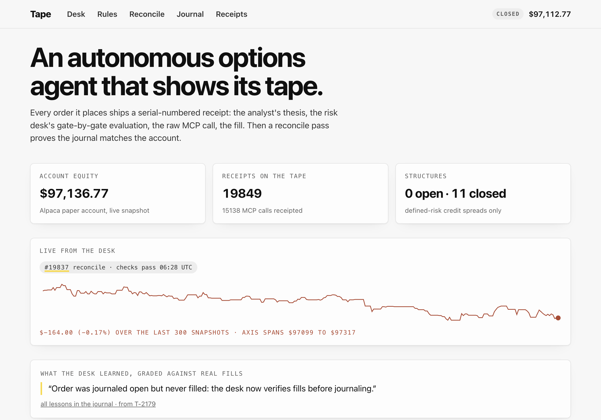
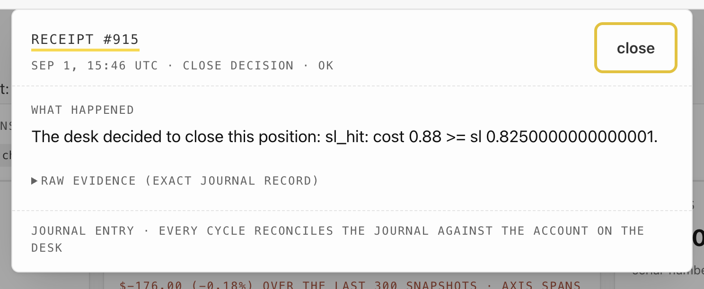

# Tape: the proof-carrying options desk

An autonomous options agent on Alpaca paper that prints a serial-numbered receipt for everything it does, then reconciles its own journal against the broker every cycle. The tape doesn't lie. Now the agent can't either.



| | |
|---|---|
| Live desk | [tape.up.railway.app](https://tape.up.railway.app) |
| Demo video | [demo-take/tape-demo-v6.mp4](demo-take/tape-demo-v6.mp4) (2:46, the real desk, real receipts) |
| Paper account | `PA37YPE0PC51` (Alpaca paper, $100,000 start) |
| Stack | Python agent · Alpaca MCP server · Groq · FastAPI · Next.js 15 |

## Judge it in 90 seconds

1. Open the [live desk](https://tape.up.railway.app): equity tile is the real Alpaca paper account, ticking. The front page shows losses in red next to wins.
2. Click any row on the [desk blotter](https://tape.up.railway.app/desk/): the receipt unfolds. What happened, the analyst's reasoning, the trade in English, cash collected, worst case, and the 13 gates it passed to exist.
3. Open [Rules](https://tape.up.railway.app/rules/): every gate evaluation on record, including the 22 blocked proposals and the exact gate that killed each one.
4. Open [Reconcile](https://tape.up.railway.app/reconcile/): every cycle the journal is compared against the broker's actual positions. The clean stamps are the product.

## The proof, in numbers

Live counts, pulled from the running desk at write time. Every one of these is clickable on the site and traceable to a serial number.

| What | Count | Verify |
|---|---|---|
| Serial-numbered receipts | 19,849+ | [Receipts](https://tape.up.railway.app/receipts/), every one lookup-able by number |
| Journaled MCP calls | 15,138 | Home tile, raw payloads preserved |
| Gate evaluations | 33 runs · 11 approved · 22 blocked | [Rules](https://tape.up.railway.app/rules/) |
| Reconcile passes | clean, every cycle | [Reconcile](https://tape.up.railway.app/reconcile/) |
| Self-graded lessons | 10 | [Journal](https://tape.up.railway.app/journal/) |
| Closed spreads (fresh account) | 11 closed · +$447.50 realized | [Desk](https://tape.up.railway.app/desk/) and `/api/trades` |

## The account

| | |
|---|---|
| Submission account | `PA37YPE0PC51` · Alpaca paper · $100,000 start · options level 3 |
| Equity at write time | ~$97,100 (live on the desk tile; it ticks with the market) |
| Closed spreads | 11, realized +$447.50; losses sit in red on the front page |
| On the book now | -200 SPY short stock from a Sep 3 expiry assignment, marked live; every position read is itself a receipt |

## Honesty table

| Real | Limits, stated |
|---|---|
| The live site is the real agent's journal: same process that trades the account writes the tape. | Paper trading only. No real money anywhere. |
| Blocked trades are receipted with the exact gate and values. 22 proposals died on the record. | The first account (`PA3CT53IRO63D`) blew up Sep 2: the desk froze for ~90 minutes, held 0-DTE spreads into expiry, and assignment left it at -$54,152. That account is retired and archived in `agent/archive/`. |
| The freeze is why the reconcile system exists: day two it caught six journal-vs-broker mismatches in public, repaired them, and wrote the lesson down. | A Sep 3 expiry left the fresh account holding -200 SPY short stock (assignment). It is marked live in the equity tile, visible in `get_all_positions` receipts, and unchanged by this README. |
| Sizing, gates, and flattens are deterministic code. The LLM can only ever propose; it cannot size a trade or weaken a rule. | The analyst runs on Groq; its reasoning is printed verbatim in every trade receipt, including when it is wrong. |

## How it works

```
Groq analyst ──proposal──▶ 13 deterministic gates ──approved──▶ Alpaca MCP order (mleg)
                               │                                     │
                               │ blocked: receipted with reasons      ▼
                               ▼                              journal (SQLite + JSONL)
                          Rules page                          serial receipts, append-only
                                                                     │
     Journal ◀── nightly self-grades (lessons)                every cycle
       ▲                                                            ▼
       └────────────── reconcile: journal vs broker account ── clean stamp or diffs + repair
```

The core of the risk desk. The LLM proposes; this code disposes, and both outcomes are journaled:

```python
r.check("per_trade_max_loss",
        max_loss <= PER_TRADE_MAX_LOSS * equity,
        {"max_loss": round(max_loss, 2), "cap": round(PER_TRADE_MAX_LOSS * equity, 2)})
...
journal.gate_eval(serial, proposal, approved=r.approved, reasons=r.gates)
```

Thirteen gates run before any order exists: market open, no last-30-minute entries, 2.5% NAV per trade, 20% aggregate open risk, 4% daily halt-and-flatten, short-leg delta band 0.10-0.40, max 5 DTE, same expiry both legs, max 2 structures per ticker, short strike pin guard, liquidity check, credit-not-debit, Friday flatten window.

## The app



Every row on the desk blotter opens its receipt. This one is a close decision: the desk's stop-loss fired (cost 0.88 >= stop 0.825), and the receipt shows the exact journal record behind it. Nothing is summarized away; the raw evidence is one click further.

## Demo video

[demo-take/tape-demo-v6.mp4](demo-take/tape-demo-v6.mp4), 2:46. Recorded against the live desk, no cuts to mockups.

| Time | Scene |
|---|---|
| 0:00 | Front door: live equity, the honest sparkline |
| 0:22 | The blotter: losses in red next to wins |
| 0:52 | A fill clicked: the receipt unfolds (analyst reasoning, trade, cash, worst case) |
| 1:26 | Rules: 33 evaluations, 22 blocks, the 13 gates expanded |
| 1:51 | Reconcile: the clean-pass wall |
| 2:18 | Journal: lessons from real fills |
| 2:31 | Receipts by number + where to look |

## Stack

- **Agent**: Python, stdio MCP client against Alpaca's MCP server, Groq for the analyst, SQLite + JSONL journal
- **Panel**: FastAPI sidecar + Next.js 15 static export
- **Hosting**: Railway, one container running the desk loop and the panel

## Run locally

```bash
cd agent
pip install -r requirements.txt
cp .env.example .env         # Alpaca paper keys + GROQ_API_KEY
python scripts/run_desk.py   # desk loop + panel API (uvicorn tape.api:app)
```

## Project structure

```
agent/src/tape/        desk loop, analyst, strategy, risk gates, journal, executor
agent/src/tape/api.py  panel API (state, trades, receipts, reconcile, gate evals)
panel/                 Next.js 15 front end (static export)
agent/archive/         the Sep 2 blown account, kept as a receipt chain
demo-take/             demo video + VO pipeline
docs/media/            screenshots in this README
```

## License

MIT (see LICENSE).

## Credits

Built by [Raphie](https://x.com/a_raphie) for the lablab.ai × Alpaca AI Trading Agents Hackathon.
